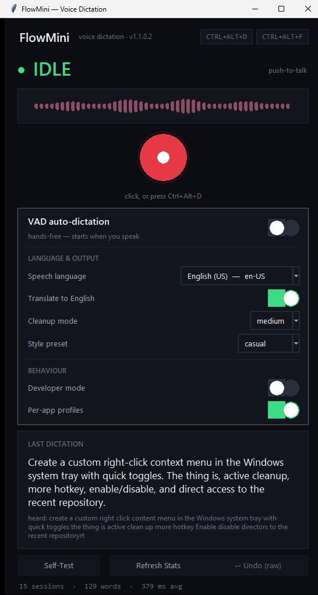

<div align="center">

# 🎙️ FlowMini

**Speak anywhere, type everywhere.**

A lightweight, offline-first voice dictation app for Windows in the spirit of Wispr Flow —
built with pure Python, local Whisper speech-to-text, and a deterministic text-cleanup engine.

`mic → local ASR → smart cleanup → instant paste into any app`

[](LICENSE)


-green)




</div>

---

## ✨ Why FlowMini?

Typing is the slowest part of using a computer. FlowMini turns speech into clean,
punctuation-correct text **inside whatever window you're focused on** — a code editor,
a chat box, a search bar, an email, a LeetCode editor. No cloud upload of your voice,
no subscription, no telemetry you didn't ask for.

| | |
|---|---|
| 🧠 **Local-first** | Speech-to-text runs on your machine with Faster-Whisper. Your audio never leaves your computer. |
| ⚡ **Fast** | Raw text appears ~1s after you stop speaking; the default cleanup mode is offline and finishes in milliseconds. |
| 🧹 **Actually clean text** | A deterministic "Speech Transform Engine" removes fillers, fixes self-corrections, and converts *spoken symbols* into real punctuation. |
| 🌍 **100+ languages** | Auto-detects the language you speak per utterance — or translate everything to English on the fly. |
| 🔌 **Optional AI polish** | Level up to an LLM rewrite (OpenRouter / Gemini / OpenAI) for tone and style. Fully optional. |
| 🕵️ **Private by default** | The only network call in the whole app is the optional polisher. Everything else is local. |
| 🎯 **Per-app profiles** | Dictating in VS Code? Developer mode, no mangled identifiers. In Outlook? Formal style — each window picks its own mode automatically. |
| 🪟 **Floating HUD** | A borderless always-on-top card appears near your cursor while dictating — status, live mic level, and the final text, even with the app minimized to the tray. Never steals focus. |

## 🚀 Quick start

### Option A — download the app (no Python needed)

1. Grab **`FlowMini-win64.zip`** from the [latest release](../../releases/latest).
2. Unzip it anywhere and double-click **`FlowMini.exe`** inside the `FlowMini` folder.
   First launch downloads the Whisper model once (~1.5 GB), then everything runs offline.
   Settings, the session log and models all live next to the exe, so keep the folder together.
3. Press **Ctrl+Alt+D**, speak, release — your text lands in the focused window.

> Only **one instance at a time**: launching a second copy shows an "already running"
> notice instead of silently fighting your first copy for the mic and the hotkey.

> **Optional:** create a `.env` file next to the exe with `OPENROUTER_API_KEY=...`
> to unlock the AI-polish tier. The default mode needs no key and no internet.

*Windows Defender / SmartScreen may warn about unsigned binaries — this is a hobby
project built locally, choose "More info → Run anyway" if you trust it, or build
from source below.*

### Option B — run from source

```powershell
git clone https://github.com/tjmhmdaarif/FlowMini.git
cd FlowMini

python -m venv .venv
.venv\Scripts\activate
pip install -r requirements.txt

python flowmini_app.py      # or double-click run_flow.bat
```

## ⌨️ Global hotkeys

Work in **any** app, even when FlowMini is minimized to the tray.

| Hotkey | Action |
|---|---|
| **Ctrl+Alt+D** | **Push-to-talk** — press once, speak, press again → polished text pastes in |
| **Ctrl+Alt+F** | **Hands-free VAD** — speak naturally; it stops on silence and pastes automatically |

Change them anytime in `config.json` (`trigger_key`, `vad_trigger_key`).
Some combos get stolen by graphics-card drivers — if a key does nothing, pick
another from `KEY_MAP` in `flow_mini.py`.

## 🧹 The Speech Transform Engine

Raw Whisper output is messy. Before anything is pasted, a deterministic,
language-aware engine cleans it up — and logs every change it makes (with one-step undo):

| You say | You get |
|---|---|
| `um let's fix the the parser no the tokenizer` | `Let's fix the tokenizer.` |
| `open square bracket self close paren` | `[self]` |
| `new paragraph` | real paragraph break |
| `meet Tuesday, actually Wednesday` | `Meet Wednesday.` |

Three cleanup modes (set `cleanup_mode` in `config.json` or use the in-app dropdown):

| Mode | Behavior | Network |
|---|---|---|
| `off` | Paste the raw transcript | none |
| `light` *(default)* | Symbols, fillers, corrections, punctuation, capitalization | **none** |
| `medium` | `light` + optional LLM rewrite (tone/style presets) | OpenRouter |

## 🗣️ Languages

- **Auto-detection on by default** — speak Hindi, Kannada, Spanish, whatever; Whisper
  figures it out per utterance and logs the detected language + confidence.
- **Script-aware romanization** — non-Latin speech is shown in readable English letters
  (`heard (hi · 97%): namaste doston`) while the *original script* is what gets pasted.
  Covers Hindi, Marathi, Nepali, Kannada, Telugu, Tamil, Malayalam, Bengali, Gujarati,
  Punjabi, Urdu, Arabic, Persian, and more via `translit.py`.
- **Translate-to-English toggle** — everything you say is transcribed *and pasted* as English.

## 🎯 Per-app profiles

FlowMini already watches which window you're focused on (that's where the text
lands). It now also switches **how it writes**, per app — no clicking, no toggling:

| You dictate in | Profile | What changes |
|---|---|---|
| VS Code, Cursor, terminals, … | `code` | **Developer mode** — no sentence capitalization, no forced trailing period: `import os` stays `import os` |
| Outlook, Mail, Thunderbird, … | `mail` | **Formal style** preset for the AI polish |
| anything else | *(default)* | your global settings, untouched |

- Rules match the **process name** (`code.exe`) and/or the **window title**
  (`*Gmail*` — handy for webmail in a browser): case-insensitive, `*` wildcards,
  first matching rule wins.
- The profile is chosen **when a dictation starts** and applies to that utterance
  only — your global `developer_mode` / `style_preset` / `cleanup_mode` are never
  modified, so switching apps switches back automatically.
- The built-in `code` + `mail` rules ship enabled. Customize or turn the whole
  feature off in `config.json`:

```json
"app_profiles_enabled": true,
"app_profiles": [
  {"name": "code", "apps": ["code.exe", "*cursor*", "*terminal*"],
   "developer_mode": true},
  {"name": "mail", "apps": ["outlook.exe"], "title": ["*gmail*"],
   "style_preset": "formal"},
  {"name": "meetings", "apps": ["zoom.exe"], "cleanup_mode": "light"}
]
```

- Allowed overrides per rule: `developer_mode`, `style_preset`, `cleanup_mode`.
- The active profile is logged (`Profile 'code' · code.exe`) and shown as a chip
  on the HUD while recording; the **Per-app profiles** switch in the app turns
  the feature on or off without editing config.

## ⚙️ Configuration

FlowMini reads `config.json` next to the exe (or script). Everything is optional —
defaults are baked in. Highlights:

```json
{
  "trigger_key": "ctrl+alt+d",
  "cleanup_mode": "light",
  "stt_model": "large-v3-turbo",
  "stt_device": "auto",
  "detect_language": true,
  "translate_to_english": false,
  "show_hud": true,
  "app_profiles_enabled": true
}
```

- `stt_model`: `tiny` (fastest) → `base` → `small` → `medium` → `large-v3-turbo` (most accurate)
- `stt_device`: `auto` picks GPU when available, otherwise CPU with `int8` quantization
- `custom_dictionary.json`: your own phrase expansions, applied **before** cleanup
- `snippets.py`: define shortcodes that expand into full blocks of text
- `developer_mode`: code-aware vocabulary and formatting
- `show_hud`: the floating dictation card near your cursor (default `true`)
- `app_profiles_enabled` / `app_profiles`: per-app behaviour rules — see
  [Per-app profiles](#-per-app-profiles) above

## 🗓️ Roadmap

One focused improvement per day:

- [x] **Day 1** — floating dictation HUD (status + mic level + text near the cursor)
- [x] **Day 2** — first-run model download progress (live % and MB in the HUD + main window, resume-safe)
- [x] **Day 3** — per-app profiles (code mode in editors, formal style in mail)
- [ ] Day 4 — auto-start with Windows + tray quick-menu
- [ ] Day 5 — CI: the EXE builds automatically on every tag
- [ ] Day 6 — winget manifest (`winget install FlowMini`)
- [ ] Day 7 — streaming partial transcript (words appear while you speak)

## 📊 Extras

- **Session telemetry** — every dictation (duration, word count, end-to-end latency)
  is logged to a local SQLite file (`flowmini_sessions.db`). Query it with `--stats`.
- **Model download progress** — picking a Whisper model shows live percentage and
  MB counters while it downloads; already-downloaded models load with zero extra
  network round-trips.
- **Paste follows your focus** — the target window is re-checked at paste time, so
  moving between apps while dictating lands the text where you actually are
  (taskbar/desktop/Start-shell never receive text by accident).
- **Auto-learn** — repeated manual corrections are learned and applied automatically next time.
- **Microphone recovery** — the audio stream re-opens itself on device errors.
- **Graceful degradation** — missing API key or unreachable polisher never breaks dictation;
  it falls back to the raw transcript.

## 🛠️ Building the app yourself

```powershell
pip install pyinstaller
.venv\Scripts\pyinstaller.exe FlowMini.spec --noconfirm
# → dist\FlowMini\FlowMini.exe  (+ _internal\ libs — keep the folder together)
```

## 🧪 Tests

```powershell
python tests_speech_transform.py     # Speech Transform Engine (47 checks)
python tests_translit.py             # script-aware romanization (20 checks)
python tests_model_progress.py       # Day-2 model download progress (18 checks)
python tests_single_instance.py      # single-instance mutex guard (7 checks)
python tests_profiles.py             # Day-3 per-app profiles (58 checks)
```

All five suites are orchestration-safe: they run offline (no microphone, no API key,
no Ollama), and the single-instance guard has a `FLOWMINI_MULTI=1` bypass so test
harnesses can run multiple copies without touching your real config.

## 📁 Project layout

```
FlowMini/
├── flow_mini.py            # core engine: audio → ASR → cleanup → injection
├── flowmini_app.py         # GUI (tkinter): control panel, tray, global hotkeys
├── speech_transform.py     # deterministic post-ASR cleanup engine
├── translit.py             # script-aware romanization for 13+ languages
├── snippets.py             # shortcode → text expansion
├── auto_learn.py           # learns from your corrections
├── FlowMini.spec           # PyInstaller build recipe
└── docs/screenshots/       # the pictures on this page
```

## 🔐 Privacy

- Audio is captured and transcribed **entirely on-device**.
- The single optional network call is the `medium`-mode LLM polish, sent to the
  provider *you* configure with *your* key.
- Telemetry stays in a local SQLite file in this folder. Delete it any time.

## ⚠️ Disclaimer

FlowMini is an independent, open-source project **inspired by** the UX of Wispr Flow.
It is not affiliated with, endorsed by, or connected to Wispr. Nothing here ships or
extracts proprietary Wispr code — it is an original reimplementation of the *idea* in Python.

## 📄 License

[MIT](LICENSE) — do whatever you like, attribution appreciated.

<div align="center">
<sub>Built with 🎙️ Python, Faster-Whisper, and a lot of dictation testing.</sub>
</div>
